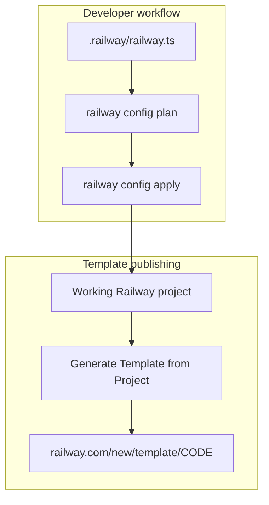
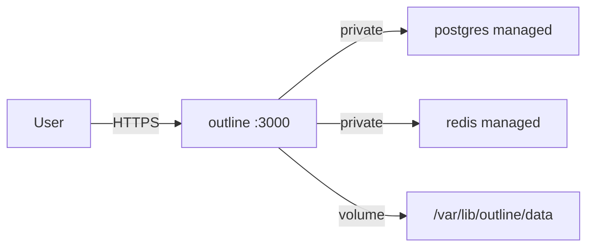

# Outline Railway Deployment Plan

## Current state

The `outline/` folder has partial, conflicting config:

| File | Status |
|------|--------|
| [`template.json`](template.json) | Complete spec (postgres:18 + redis:7-alpine + outline Docker image) — **not consumed by CLI** |
| [`railway.toml`](railway.toml) | Valid deploy settings — **conflicts with IaC** if both manage the same service |
| [`.railway/railway.ts`](.railway/railway.ts) | Stub with single `web` service — **incomplete** |
| [`package.json`](package.json) | `railway@^3.7.0` installed — SDK ready |

`railway config plan` failed because the stub `railway.ts` does not define the real stack. The SDK is installed; the IaC file still needs to be written.

## Deployment model

Use **two complementary paths** with clear roles:



- **IaC** (`railway config apply`) — provisions and manages the stack from code
- **Template** (dashboard) — one-click deploy for end users, generated from a working project

[`template.json`](template.json) remains a human-readable reference; Railway does not import it automatically.

## Architecture (IaC target)



Use Railway **managed** `postgres()` and `redis()` helpers (recommended over custom Docker containers — matches [existing Outline templates](https://railway.com/deploy/outline-wiki) and auto-wires `DATABASE_URL` / `REDIS_URL`).

## Changes to implement

### 1. Rewrite `.railway/railway.ts`

Replace the stub `web` service with the full stack:

```ts
import {
  defineRailway,
  group,
  image,
  postgres,
  preserve,
  project,
  redis,
  service,
  volume,
} from "railway/iac";

export default defineRailway(() => {
  const db = postgres("postgres");
  const cache = redis("redis");
  const storage = volume("outline-data");

  const outline = service("outline", {
    source: image("docker.getoutline.com/outlinewiki/outline:latest"),
    healthcheck: "/_health",
    healthcheckTimeout: 300,
    volumeMounts: {
      "/var/lib/outline/data": storage,
    },
    env: {
      NODE_ENV: "production",
      PORT: "3000",
      DATABASE_URL: db.env.DATABASE_URL,
      REDIS_URL: cache.env.REDIS_URL,
      SECRET_KEY: preserve(),
      UTILS_SECRET: preserve(),
      URL: preserve(),
      FORCE_HTTPS: "true",
      FILE_STORAGE: "local",
      FILE_STORAGE_LOCAL_ROOT_DIR: "/var/lib/outline/data",
      DEFAULT_LANGUAGE: "en_US",
      GOOGLE_CLIENT_ID: preserve(),
      GOOGLE_CLIENT_SECRET: preserve(),
    },
  });

  const backend = group("Backend", [db, cache, outline]);

  return project("outline", {
    resources: [backend, storage],
  });
});
```

Notes:

- `preserve()` keeps existing Railway values on apply (secrets, URL, OAuth) without writing them to source
- On first apply, set `SECRET_KEY`, `UTILS_SECRET`, `URL`, `GOOGLE_CLIENT_ID`, `GOOGLE_CLIENT_SECRET` in the dashboard or via `railway variables --set`
- Optional SMTP/OIDC/Slack vars from [`template.json`](template.json) can be added as `preserve()` entries

### 2. Remove `railway.toml`

Railway blocks IaC when a service is also managed by `railway.toml` ([docs](https://docs.railway.com/infrastructure-as-code)). All deploy settings move into `railway.ts`:

- `healthcheck: "/_health"`
- `healthcheckTimeout: 300`
- `volumeMounts` (replaces `requiredMountPath`)

### 3. Add npm scripts to `package.json`

```json
"scripts": {
  "plan": "railway config plan",
  "apply": "railway config apply",
  "pull": "railway config pull"
}
```

### 4. Add `README.md`

Document two workflows:

**CLI deploy (IaC):**

```bash
cd outline
railway link
npm run plan
npm run apply
# Set URL, SECRET_KEY, UTILS_SECRET, Google OAuth in dashboard
```

**Publish as Template:**

1. Verify stack works after `railway config apply`
2. Project Settings → **Generate Template from Project**
3. In Template Composer: confirm volume at `/var/lib/outline/data`, healthcheck `/_health`, public HTTP on `outline`
4. Publish → share `https://railway.com/new/template/<code>`

Include post-deploy checklist from [`template.json`](template.json) variable descriptions.

### 5. Keep `template.json` as reference

No functional change required. Optionally note in README that it mirrors the Template Composer config for manual setup / documentation.

## Deploy steps (after implementation)

```bash
cd outline
railway link                    # link to Railway project
npm run plan                    # preview: should show postgres, redis, outline, volume
npm run apply                   # provision all services
```

After first deploy:

1. Generate public domain for `outline`
2. Set `URL=https://<domain>`
3. Generate and set `SECRET_KEY` / `UTILS_SECRET` (`openssl rand -hex 32`)
4. Configure [Google OAuth](https://docs.getoutline.com/s/hosting/doc/google-hOuvtCmTqQ)

To publish template:

```bash
railway templates create --json   # from linked working project
# Review in dashboard, then publish
```

## Implementation todos

- [ ] Rewrite `.railway/railway.ts` with postgres, redis, outline service, and volume
- [ ] Delete `railway.toml` to avoid IaC conflict
- [ ] Add plan/apply/pull scripts to `package.json`
- [ ] Create `README.md` with IaC deploy and template publish instructions

## Out of scope

- Pinning Outline image version (can do later)
- S3/Railway Bucket storage (local volume chosen)
- Git commit
